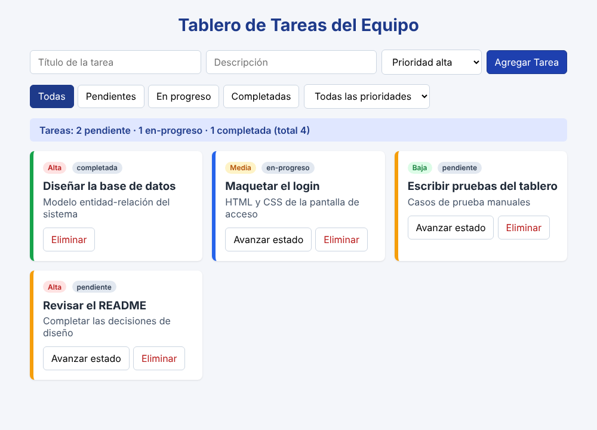
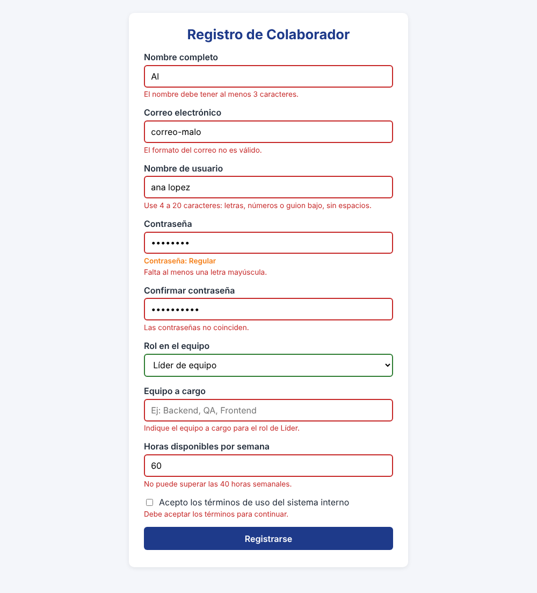
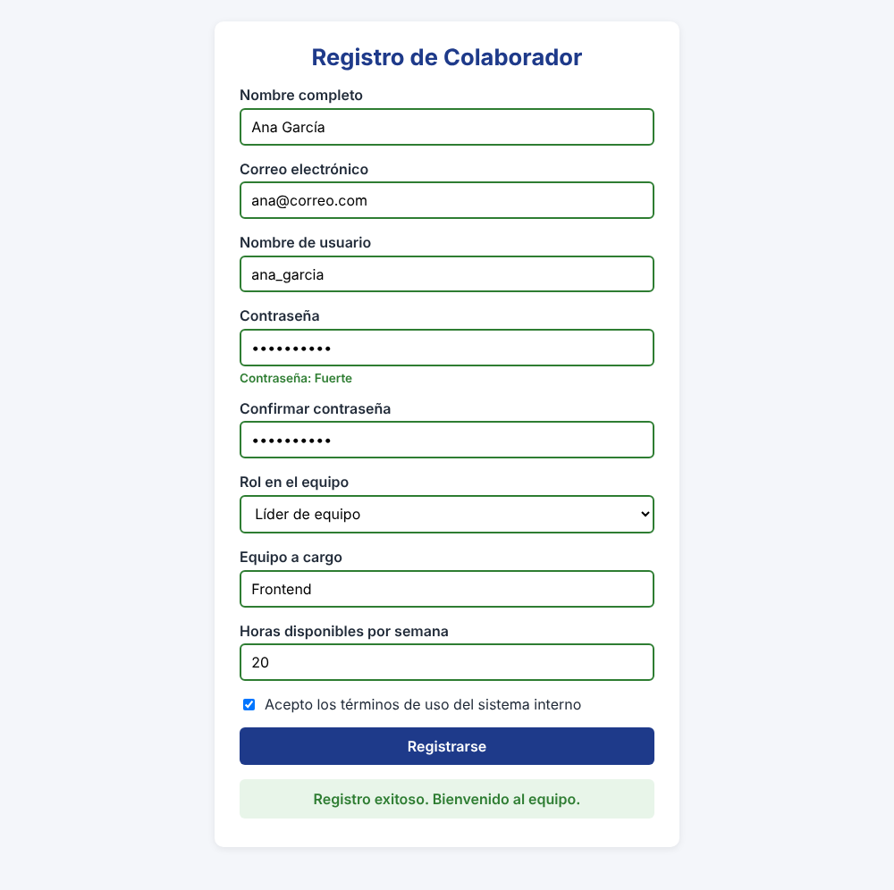

# Post-contenido — Unidad 4: JavaScript Básico

**Estudiante:** Juan David — Ingeniería de Sistemas, UFPS (Cúcuta)
**Asignatura:** Programación Web — Séptimo Semestre

## Descripción
Repositorio del laboratorio de la Unidad 4 de Programación Web.
Contiene dos partes: un tablero de tareas del equipo con manipulación
del DOM y eventos (`parte-1-tablero-tareas/`) y un formulario de
registro de colaborador con validación manual y Constraint Validation
API (`parte-2-formulario-colaborador/`). Ambas partes forman un mismo
sistema interno de equipo: el tablero organiza las tareas y el
formulario registra a quienes las tomarían.

**Tecnologías:** HTML5, CSS3 y JavaScript puro (ES6), sin librerías
externas y sin `var`.

## Parte 1 — Tablero de tareas del equipo
Tablero de tareas en JavaScript puro que implementa creación,
avance de estado y eliminación (con un único listener delegado que
distingue acciones por `data-action`), filtrado combinado por estado
y prioridad, un `switch` para la apariencia por prioridad, y
estadísticas calculadas con `reduce()` y `for...of`. Ver
`parte-1-tablero-tareas/`.

## Parte 2 — Formulario de registro de colaborador
Formulario de registro con validación completa del lado del
cliente: campo de usuario validado con `pattern`, campo condicional
"equipo a cargo" que solo aplica al rol Líder, campo numérico de
horas validado con `rangeUnderflow`/`rangeOverflow`, checkbox de
términos validado por `.checked`, control del evento `submit` y un
indicador de fortaleza de contraseña. Ver
`parte-2-formulario-colaborador/`.

## Decisiones de diseño

> NOTA PARA EL ESTUDIANTE: estos textos son un borrador. Reescríbelos con
> tus propias palabras antes de entregar (la rúbrica evalúa que expliques el porqué).

### Parte 1 — Generador de ID (Estrategia A: closure)
Elegí el closure `crearGeneradorId()` porque el contador queda privado:
ningún otro código del archivo puede reasignarlo o decrementarlo por
error, así que los ids siguen siendo únicos. Es un poco menos directo de
leer que una variable `let` global, pero gano encapsulación a cambio de
una sola función extra.

### Parte 1 — Actualización del DOM al avanzar estado (Estrategia B: reconstrucción completa)
Elegí reconstruir el tablero con `renderizarTablero()` porque así el
array `tareas` y los filtros activos son la única fuente de verdad de lo
que se ve. Es menos eficiente que modificar un solo nodo, pero evita que
el código de actualización se desincronice del HTML de
`crearElementoTarea`. Adapté `agregarTarea` y la eliminación para que
también llamen a `renderizarTablero()`, y el filtrado combinado se
redujo a llamar esa misma función.

### Parte 2 — Validación de contraseña (Estrategia B: validaciones independientes)
Elegí una comprobación por regla (mayúscula, número, carácter especial)
porque cada una muestra un mensaje específico y el usuario sabe
exactamente qué le falta. Cuesta más líneas que una regex compuesta,
pero la experiencia de usuario es mejor que con un mensaje genérico.

### Parte 2 — Campo condicional "equipo a cargo" (Estrategia A: alternar `required`)
Elegí alternar `required` desde el listener de `change` del rol para
aprovechar la Constraint Validation API como está diseñada:
`validity.valueMissing` ya refleja si el campo aplica. Como `form.reset()`
no dispara `change`, al limpiar el formulario tras el envío también
reseteo `required` a `false` manualmente.

## Cómo visualizar el proyecto
1. Clonar el repositorio: `git clone https://github.com/[usuario]/apellido-post1-u4.git`
2. Abrir la carpeta en Visual Studio Code
3. Clic derecho en `index.html` (de cada parte) → "Open with Live Server"

## Capturas de pantalla

